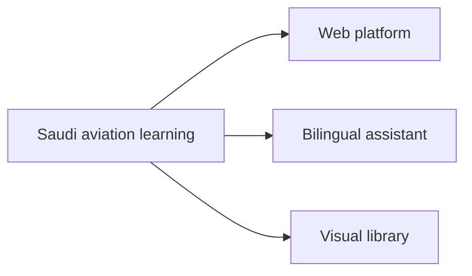

# ✈️ FlyGACA

**The Saudi Aviation Library** · **مكتبة الطيران السعودية**

Independent, bilingual (English / العربية) tools and learning resources for Saudi civil aviation — built around the GACAR regulations.

[flygaca.com](https://flygaca.com) · [Captain Adel](https://captadel.com) · [Gallery](https://gallery.flygaca.com)

---

## Choose a learning resource

Use FlyGACA for regulatory study, Captain Adel for bilingual questions with source citations, and Gallery for aviation learning graphics and artwork.

اختر فلاي جاكا لدراسة اللوائح، أو كابتن عادل للأسئلة بالعربية والإنجليزية، أو المعرض لاستكشاف المواد البصرية.

## What we build

| Project | What it is |
| --- | --- |
| **FlyGACA** | Arabic and English aviation learning platform — [flygaca.com](https://flygaca.com) |
| **Captain Adel** | Bilingual aviation learning assistant with source citations and flight calculations — [captadel.com](https://captadel.com) |
| **FlyGACA Family** | The independent, bilingual educational ecosystem for Saudi civil aviation |
| **Private Pilot Handbook** | Bilingual study material for PPL, CPL, IR and ATPL students |
| **FlightBag** | English–Arabic pilot study companion in preparation |
| **iOS** | The native iOS suite |
| **Gallery** | Aviation learning graphics, artwork, wallpapers and video — [gallery.flygaca.com](https://gallery.flygaca.com) |
| **C172** | Educational 3D model of a 1979 Cessna 172N |

## ما نقدّمه

أدوات ومصادر تعليمية مستقلة وثنائية اللغة للطيران المدني في المملكة العربية السعودية، مبنية على لوائح الطيران المدني (GACAR):

- **فلاي جاكا** — منصة طيران متكاملة للطيارين والطلاب.
- **كابتن عادل** — مدرّب طيران ذكي يجيب من نص اللائحة نفسه مع رقم المادة، أو يعتذر.
- **دليل الطيار الخاص** — مادة دراسية بالعربية والإنجليزية لرخص PPL وCPL وIR وATPL.

## Maintainer directory

The [public repository directory](https://github.com/FlyGACA/FlyGACA-Family/blob/main/REPOSITORIES.md) identifies the purpose and lifecycle of public code and community resources.

## Get involved

- Found a bug or have an idea? Open an issue in the relevant repository.
- Security issue? Please read our [security policy](https://github.com/FlyGACA/.github/blob/main/SECURITY.md) and report it privately.
- Contact: [i@flygaca.com](mailto:i@flygaca.com)

[Instagram](https://www.instagram.com/flygaca) · [LinkedIn](https://www.linkedin.com/company/flygaca) · [Snapchat](https://www.snapchat.com/@flygaca) · [Facebook](https://www.facebook.com/@flygaca)

FlyGACA is an independent project and is not affiliated with the General Authority of Civil Aviation (GACA).

